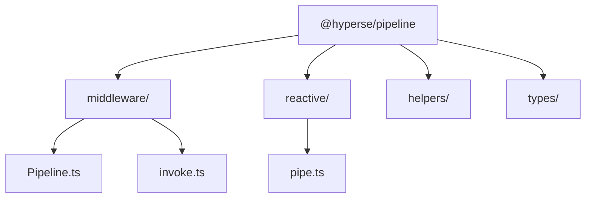
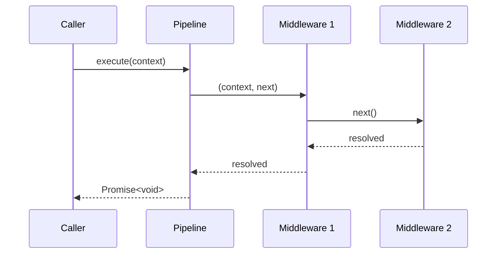
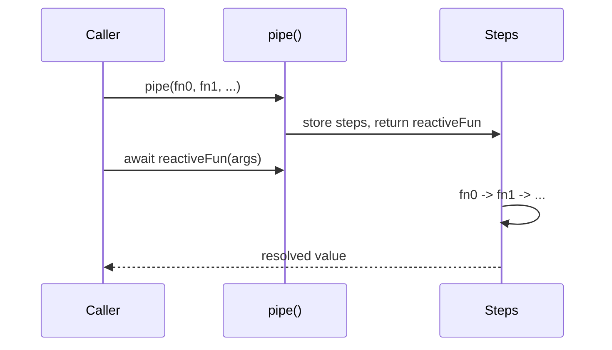

This page gives a short tour of the internals so you can reason about ordering,
error flow and early exit.

## Two independent subsystems

The two subsystems share no runtime state. `helpers/` contains small functional
utilities, and `types/` holds the type-level machinery (monad detection,
`exitPipe` extraction, return type composition).

## Middleware invocation

`Pipeline.execute()` delegates to `invokeMiddlewares`, which walks the
middleware array once:

Key points:

- Each middleware is invoked **once**, in declaration order.
- `next()` advances to the following middleware and returns a promise.
- Passing an `Error` to `next(error)` routes control to the next middleware that
  declares an error parameter.

## Reactive composition

`pipe` stores the step list in a closure and marks the resulting function with an
internal `Symbol`, which is how `context()` discovers nested pipelines to
propagate into.

Early exit is implemented by registering the wrapper object in a module-level
`WeakSet`. When a step returns a registered wrapper, composition stops and the
wrapper is returned to the caller as-is.

## Next steps

<Cards>
  <Card
    title="Reactive pipeline"
    href="/docs/reactive"
    icon={<Icon name="Workflow" />}
  >
    The public API for `pipe`.
  </Card>
  <Card
    title="Performance"
    href="/docs/performance"
    icon={<Icon name="Gauge" />}
  >
    Why the internals are shaped this way.
  </Card>
</Cards>
